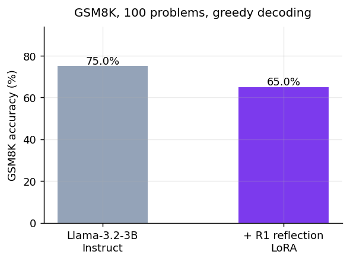
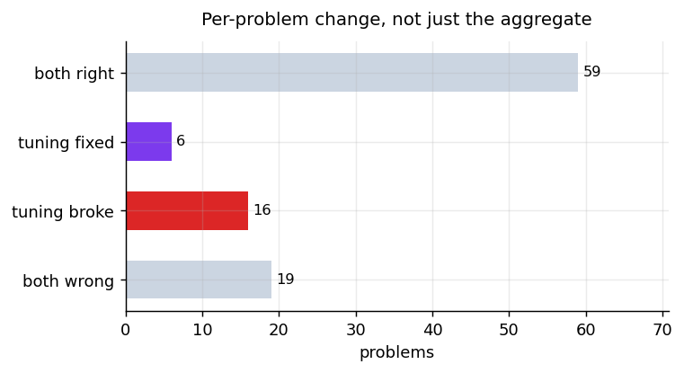
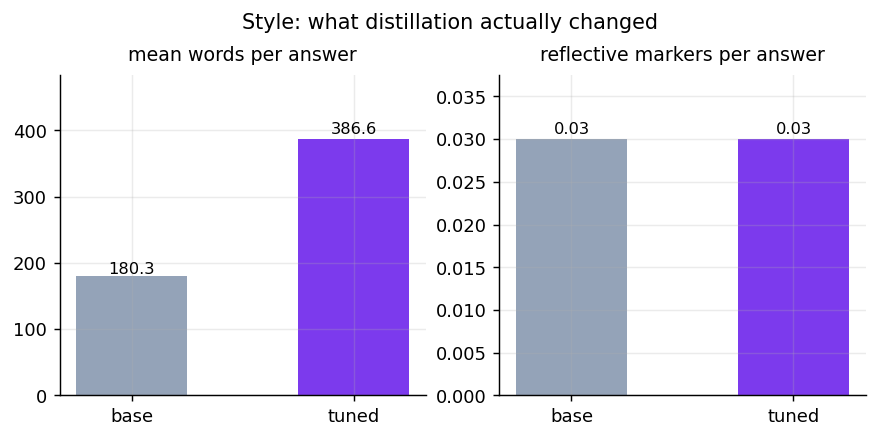
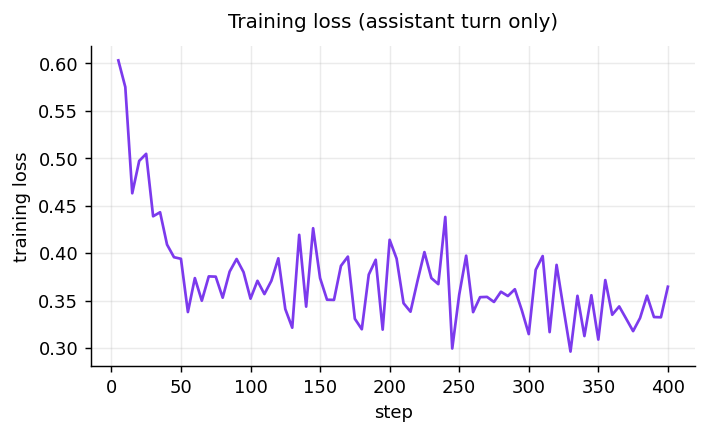

<p align="center">
  <a href="https://huggingface.co/emonHasan01/llama-3.2-3b-reflect">
    
  </a>
  <a href="https://huggingface.co/emonHasan01/llama-3.2-3b-reflect-GGUF">
    
  </a>
  <a href="https://huggingface.co/meta-llama/Llama-3.2-3B-Instruct">
    
  </a>
  
  
</p>


<div align="center">

[Hugging Face](https://huggingface.co/emonHasan01) | [GitHub](https://github.com/Md-Emon-Hasan) | [LinkedIn](https://www.linkedin.com/in/md-emon-hasan-695483237/) | [WhatsApp](https://wa.me/8801834363533) | [Portfolio](https://emonlabs-ai.hitechparks.com/)

**Author:** [Md. Emon Hasan](https://huggingface.co/emonHasan01)

</div>

# llama-3.2-3b-reflect

**Llama-3.2-3B-Instruct taught to think out loud.** A 16-bit LoRA fine-tune, trained with
[Unsloth](https://github.com/unslothai/unsloth) on
[`ServiceNow-AI/R1-Distill-SFT`](https://huggingface.co/datasets/ServiceNow-AI/R1-Distill-SFT) — DeepSeek-R1 reasoning
traces reannotated for supervised distillation.

Accuracy on GSM8K **falls** from 75.0% to 65.0%. The model reasons at greater length without reasoning better. Published as a measured result.

Available as merged 16-bit weights, as a
LoRA adapter, and as [GGUF for llama.cpp](https://huggingface.co/emonHasan01/llama-3.2-3b-reflect-GGUF).

## Results

Both models were given the **same system prompt, the same problems and greedy decoding**.
Any difference is the adapter, not the harness.



| | GSM8K accuracy | mean words | reflective markers / answer | answers showing any |
|---|---|---|---|---|
| `unsloth/Llama-3.2-3B-Instruct` | 75.0% | 180 | 0.03 | 3% |
| **this model** | **65.0%** | **387** | **0.03** | **2%** |

Aggregate accuracy hides what actually moved, so here is the per-problem breakdown:



| | problems |
|---|---|
| both models correct | 59 |
| only this model correct | 6 |
| only the base model correct | 16 |
| neither correct | 19 |

**Read that table before trusting the headline number.** A small net accuracy change can sit
on top of a large number of problems where the two models disagree in both directions.

### Style is what really changed



Reflective markers are counted by scanning for self-correction language — *wait*, *let me
reconsider*, *actually*, *double-check* and similar. It is a crude proxy, not a measure of
reasoning quality, but it tracks the thing the distillation was aiming at: visible
second-guessing rather than a single confident pass.



### Sample problems

| Question | Answer | Base | This model |
|---|---|---|---|
| Tara bought 8 packs of 5 canvas bags for $4 each. She painted them and | 160 | correct | correct |
| Mary is making ice cubes with fruit frozen in them for a cocktail part | 96 | correct | correct |
| Britany records 18 4-minute TikTok videos each week. She spends 2 hour | 1128 | wrong | wrong |

## Usage

### transformers

```python
from transformers import AutoTokenizer, AutoModelForCausalLM
import torch

tok = AutoTokenizer.from_pretrained("emonHasan01/llama-3.2-3b-reflect")
model = AutoModelForCausalLM.from_pretrained("emonHasan01/llama-3.2-3b-reflect", torch_dtype=torch.float16,
                                             device_map="auto")

messages = [
    {"role": "system", "content": "You are a reflective assistant. Think through the problem step by step in the open: explore approaches, question your own assumptions, check your arithmetic, and revise when something does not hold up. Only state a final answer once the reasoning supports it."},
    {"role": "user", "content": "How many r's are in 'strawberry'?"},
]
prompt = tok.apply_chat_template(messages, tokenize=False, add_generation_prompt=True)
inputs = tok(prompt, return_tensors="pt", add_special_tokens=False).to(model.device)
out = model.generate(**inputs, max_new_tokens=768, do_sample=True, temperature=0.6, top_p=0.9)
print(tok.decode(out[0][inputs["input_ids"].shape[1]:], skip_special_tokens=True))
```

**The system prompt is part of the model.** It was present in every training example, and
the reflective behaviour weakens noticeably without it. The exact string is in
[`prompt_format.json`](prompt_format.json).

Use `temperature=0.6` for open-ended prompts and **greedy decoding for anything numeric** —
high temperature wrecks arithmetic, which is why the evaluation above is greedy.

### llama.cpp

```bash
llama-cli -hf emonHasan01/llama-3.2-3b-reflect-GGUF:Q4_K_M \
  --system "You are a reflective assistant. Think through the problem step by step in the open: explore approaches, question your own assumptions, check your arithmetic, and revise when something does not hold up. Only state a final answer once the reasoning supports it." \
  -p "How many r's are in 'strawberry'?" -n 768
```

### Unsloth, for further training

```python
from unsloth import FastLanguageModel

model, tokenizer = FastLanguageModel.from_pretrained("emonHasan01/llama-3.2-3b-reflect", max_seq_length=2048)
FastLanguageModel.for_inference(model)
```

## Training

| | |
|---|---|
| Base model | `unsloth/Llama-3.2-3B-Instruct` (3.2B parameters) |
| Method | LoRA at **16-bit** (not 4-bit QLoRA), via Unsloth |
| Trainable | 24,313,856 parameters (0.76% of the model) |
| Rank / alpha / dropout | 16 / 16 / 0 |
| Target modules | `q,k,v,o,gate,up,down` |
| Learning rate | 0.0002, linear schedule, 10 warmup steps |
| Batch | 1 × 8 accumulation = 8 effective |
| Steps | 400 (~3,200 examples) |
| Max sequence | 2048 tokens |
| Optimizer | `adamw_8bit` |
| Peak VRAM | 7.8 GB of 15.0 |

### Decisions that mattered

**One chat template throughout.** A common failure in reasoning-distillation notebooks is to
train on a bare custom template and then infer through the model's chat template. The model
is then never asked the question it was taught. Training, evaluation and the usage snippets
above all go through Llama 3.1's template with the same system prompt.

**Loss on the assistant turn only.** `train_on_responses_only` masks everything up to the
assistant header. Without it most of the gradient goes into regenerating the problem
statement, which is always supplied at inference anyway.

**16-bit rather than 4-bit.** A quantized base saves memory but pays dequantisation cost on
every forward pass. At 3B the fp16 base already fits with Unsloth's gradient
checkpointing, and keeping full precision means the merged model converts straight to GGUF
with no intermediate step.

**Long examples dropped, not truncated.** A reasoning trace cut off mid-thought teaches the
model to stop reasoning halfway. Examples over 2048 tokens were filtered out instead.

## Limitations

- **This is a 3B model.** It is not competitive with frontier reasoning models, and the
  reflective style can resemble careful reasoning while still arriving at a wrong answer.
  Visible self-correction is not a guarantee of correctness.
- **Evaluated on 100 GSM8K problems**, not the full 1,319-problem test set. Expect a
  few points of sampling noise; differences smaller than that are not meaningful.
- **One benchmark, one domain.** GSM8K is grade-school arithmetic. Nothing here measures
  code, science, multi-step planning, or factual accuracy, and nothing measures whether the
  stated reasoning matches the computation that produced the answer.
- **Reflective markers are a keyword count**, not a judgement of reasoning quality. They
  show the style changed, not that it got better.
- **Longer outputs cost more.** The model generates roughly 2.1× as many tokens as the
  base for the same problem, which is latency and money in production.
- **Trained on R1 distillation data**, inheriting whatever biases and errors those traces
  contain. No faithfulness or safety evaluation was run.

Do not use this where a wrong answer matters without a human checking the result.

## Reproducing

Produced the baseline, the training, all four charts, both model cards and the GGUF builds. Raw numbers in [`results.json`](results.json).

## Citation

```bibtex
@software{unsloth,
  title  = {Unsloth},
  author = {Daniel Han and Michael Han and Unsloth team},
  year   = {2023},
  url    = {https://github.com/unslothai/unsloth}
}
@article{deepseek2025r1,
  title   = {DeepSeek-R1: Incentivizing Reasoning Capability in LLMs via Reinforcement Learning},
  author  = {DeepSeek-AI},
  year    = {2025}
}
@article{cobbe2021gsm8k,
  title   = {Training Verifiers to Solve Math Word Problems},
  author  = {Cobbe, Karl and others},
  journal = {arXiv:2110.14168},
  year    = {2021}
}
```
